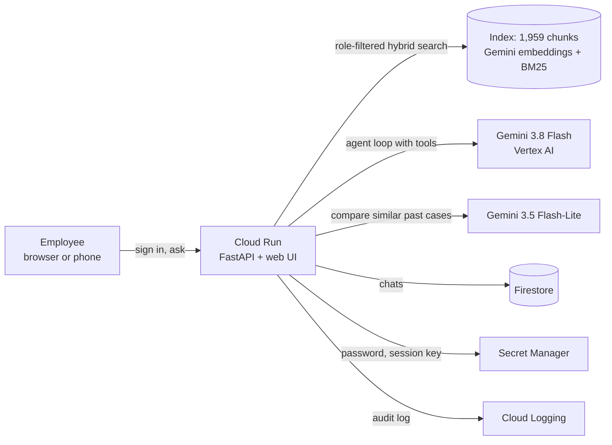

# TouchStone

**The knowledge assistant that knows what it doesn't know, who to trust, and who can see what.**

TouchStone answers employees' questions about how their company really works, from policies, Confluence pages,
ServiceNow tickets, email and Slack. Unlike a plain "chat with your documents" bot, it notices when the written rule
and actual practice disagree, when the same question was answered differently before, who the right person to ask is,
and what each employee is allowed to see.

Built for the **Gen AI hackathon (AI Builder Cup)** on **Google Cloud**: Gemini models on Vertex AI, deployed on Cloud Run.
The company in the demo, **AlgoWorks**, is fictional: a 1,000-person B2B SaaS firm with a fully synthetic dataset.

---

## Try it live

**URL:** https://kb-copilot-304689352997.us-central1.run.app

1. Open the link (works on desktop and phone).
2. In **Employee**, start typing a name from the table below and pick it from the list.
3. Enter the password: **`TouchStone-67c193`** (the same for every test account).
4. Ask a question, or try the suggested ones for that person.

Answers usually take 5–25 seconds (about 17 s typical). Each account is limited to 20 new answers per 10 minutes.

### Test accounts (different roles, different access)

Everyone can see all non-confidential knowledge. **Confidential** records (personal data such as pay or leave reasons,
and restricted business records) are need-to-know; there are 236 of them out of 1,897 records.

| Sign in as | Job title | Access roles | Confidential records visible | Try asking |
|---|---|---|---:|---|
| **Harish Gowda** | Site Reliability Engineer | employee | 10 / 236 | "Do I need a change request to deploy to production?" (policy vs practice) |
| **Aditya Rao** | Senior Frontend Engineer | employee | 3 / 236 | "When will my referral bonus be paid?" (sees his own case, not others') |
| **Swati Kulkarni** | HR Business Partner (Eng & IT) | HR business partner | 68 / 236 | "Has anyone in Engineering had problems getting their referral bonus paid?" |
| **Vijay Kumar** | Payroll Specialist | payroll admin | 64 / 236 | "When is the referral bonus paid?" (pay data, but not leave reasons) |
| **Nikhil Bhatt** | IAM & Security Lead | security admin, people manager | 50 / 236 | "Can Customer Success get access to the AlgoWorks Admin Console?" |
| **Vivek Anand** | Chief Financial Officer | executive, finance controller, department head | 141 / 236 | "Who needs to approve a 25% discount?" (business secrets, no personal data) |
| **Revathi Krishnaswamy** | General Counsel | compliance auditor, legal counsel | 236 / 236 | Anything: sees all, and every confidential access is flagged for audit |
| **Yash Suri** | Contract Analytics Engineer | contractor | 0 / 236 | "When is the referral bonus paid?" (documentation only) |
| **Pradeep Chauhan** | Former Data Protection Officer | has left the company | — | Not in the sign-in list: people who have left can't sign in |

**Good questions for any account**

- "Who approves Snowflake PII access now that the DPO has left?" (routes to an active person, not the one who left)
- "Has the VPN disconnecting every 30 minutes on Wi-Fi been solved before?" (conflicting past fixes)
- "What is the deadline for submitting expense claims?" (written policy vs what Finance actually accepts)
- "How many leave days can I carry forward to next year?" (a clean answer: policy and practice agree)

Ask a follow-up in the same chat ("And for infrastructure changes?") and it keeps the context. Ask the same question
as two different people to see role-scoped answers.

---

## Demo video

[](VIDEO_URL)

<!-- Replace VIDEO_URL above with the YouTube (unlisted) or GitHub Release link to "TouchStone - Demo Video.mp4". -->

---

## What makes it different

| | Behaviour | Example |
|---|---|---|
| ⚖️ | **Policy vs practice**: flags when what happens differs from what's written | The change policy says every deploy needs a CAB-approved change request; since Dec 2025 a merged GitOps PR is the approval |
| ↕️ | **Conflicting past answers**: shows when the same question got different answers | HR told one engineer "90 days" and another "6 months" for the same referral-bonus question |
| 👤 | **Who to ask**: names a current owner, never someone who has left | The Data Protection Officer left in Feb 2026; it routes to who actually approves now |
| 🔒 | **Access-aware**: answers only from what you may see, says what was withheld and who can grant access | An engineer asking about bonuses gets the policy, plus a note that other people's bonus cases were withheld |

Every answer cites its sources (click a number to open the record), shows status chips (policy differs from practice,
conflicting past answers, records withheld, sources agree), names a contact, and can show "How I found this".

---

## How it works



1. **Sign-in and scope.** The session holds only the employee ID; what they can see is recomputed on the server from
   the directory on every request (14 access roles plus need-to-know).
2. **Retrieval.** Hybrid search (Gemini embeddings + keyword BM25, rank fusion), filtered by access *before* anything
   reaches the model, with reserved slots for governing policies and links to newer related records.
3. **Signals computed at ingest** (never from the dataset's answer key): document age, owners who have left, open
   policy-update requests, newer records that reference a policy.
4. **Similar past cases.** Tickets about the same issue are grouped by embedding similarity, and a second, cheaper
   Gemini model judges whether they were handled the same way.
5. **Agent.** A Gemini function-calling loop (search, open record, related records, person lookup, owner lookup) ends
   in a structured answer. Code then checks it: citations only to records the user may see, staleness flags, active
   contacts only, and an access note when records were withheld.
6. **Personal-data check at ingest.** Gemini Flash-Lite reviews every record; records with personal data (pay, health
   or leave reasons, performance, contact details) become confidential even if the source didn't label them.

### Google Cloud services used

| Service | Used for |
|---|---|
| **Vertex AI: Gemini 3.8 Flash** | The answering agent (with Gemini 2.5 Flash as a fast fallback) |
| **Vertex AI: Gemini 3.5 Flash-Lite** | Similar-case comparison and the personal-data check |
| **Vertex AI: gemini-embedding-2** | Embeddings for search (768 dimensions) |
| **Cloud Run** | Hosts the app (one container: API + web UI) |
| **Cloud Build, Artifact Registry** | Builds and stores the container on each deploy |
| **Firestore** | Per-employee chat history |
| **Secret Manager** | Sign-in password and session-signing key |
| **Cloud Logging** | Structured audit log of every answer and confidential access |

All model calls use Gemini on Vertex AI through a service account; there are no API keys and no non-Google models.

---

## Results

Measured on 18 Oct 2026 with the project's own test scripts against the live system; raw outputs and arithmetic are in
[docs/BENCHMARKS.md](docs/BENCHMARKS.md).

| Measure | Result |
|---|---|
| Typical answer time | **~17 s** median, **3.9× faster** than before tuning (pre-retrieval, hedged model calls, short answers) |
| Right policy found | **93%**: governing policy in the top 8 search results for 25 of 27 test questions |
| Drift / conflict flags | **6 / 8** demo questions with both flags right |
| Access control | **70 / 70** automated checks pass (role rules, session forgery, sign-in rate limit, leak checks across search, tools, agent answers and chat history) |
| Cost | **about ₹1 (≈ $0.011) per question** in Gemini tokens; see [docs/COST_PER_QUESTION.md](docs/COST_PER_QUESTION.md) |

---

## Run it yourself

You need Python 3.11, the Google Cloud CLI, and a Google Cloud project with the Vertex AI API enabled. The search
index is already built and committed, so no re-indexing is needed.

```bash
git clone <this repository's URL>
cd <repository folder>
python -m venv .venv
.venv/Scripts/python -m pip install -r requirements.txt      # on macOS/Linux: .venv/bin/python
cp .env.example .env                                          # then set GOOGLE_CLOUD_PROJECT, DEMO_PASSWORD, SESSION_SECRET
gcloud auth application-default login
.venv/Scripts/python -m uvicorn app.main:app --port 8010
```

Open http://localhost:8010. Without Firestore access, chat history falls back to in-memory storage.

Useful commands:

```bash
python -m scripts.test_access            # access-control checks (add --agent for live Gemini checks)
python -m scripts.eval_agent             # answer quality on the demo questions
python -m app.ingest                     # rebuild the index after changing data/
python generate/build.py && python generate/validate.py   # regenerate the synthetic dataset
```

Deploying to Cloud Run is described step by step in [docs/BUILD_GUIDE.md](docs/BUILD_GUIDE.md) §4.4–4.5.

---

## Repository layout

```
app/            FastAPI app: agent, tools, retrieval, access rules, sign-in, chat history, ingestion
app/static/     web UI (sign-in page and chat app; plain HTML/CSS/JS)
data/           synthetic AlgoWorks dataset (policies, tickets, emails, Slack, Confluence, people)
generate/       deterministic dataset generator and validator
index/          prebuilt search index (chunks, embeddings, personal-data verdicts)
scripts/        evaluation and access-control tests
docs/           build guide (every step with commands) and cost calculation
```

More detail: [docs/BUILD_GUIDE.md](docs/BUILD_GUIDE.md) (how it was built, step by step),
[CHUNK_SCHEMA.md](CHUNK_SCHEMA.md) (data contract and access model), [data_README.md](data_README.md) (the dataset),
[PROJECT_HANDOVER.md](PROJECT_HANDOVER.md) (goals, constraints and progress log).

---

## Notes

- **All data is synthetic.** AlgoWorks, its employees, tickets and messages are generated; any resemblance to real
  people or companies is coincidental. SaaS product names (Okta, Salesforce, …) are only tools the fictional company uses.
- The shared password exists so judges can try every role; a real deployment would use the company's single sign-on.
- `data/demo_queries.json` and fields like `is_stale_by_design` are a test answer key. The app never reads them; they
  are used only by the evaluation scripts.
